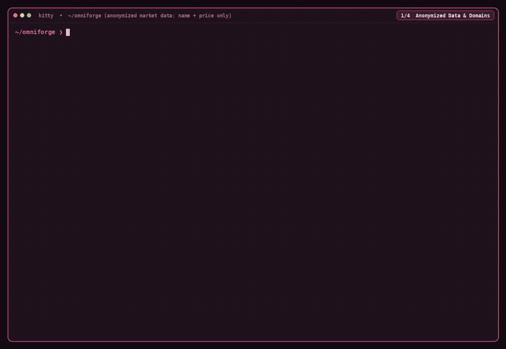

# Knapset

Knapset is a dependency-free Python framework for analyzing marketplace listings and optimizing compatible, budget-constrained sets. It reads normalized item datasets from a local SQLite database, filters out defective or mispriced candidates through pluggable domain rules, and synthesizes compatible multi-slot sets within a budget (CLI: `ks` / `knapset`).

The core repository is **domain-agnostic**. Domain schemas, scoring weights, compatibility rules, and defect analyzers can be declared via JSON blueprints (`DomainLayout`), scaffolded locally (`main.py module new`), or installed dynamically from an external extension registry (`knapset-registry`).

```
data/*_market_cache.json  --->  knapset_market.db  --->  knapset (core)  <---  knapset-registry
   (local JSON datasets)           (SQLite + FTS5)           (CLI / Web / MCP)        (domain plugins)
```

---

## Demo

- **Demo (`docs/demo.gif`)** shows the `ks` Unix CLI workflow (`domains`, anonymized market cache inspection, `sync`, and `value` vs `best` modes).



---

## What is in this repo

- **Constraint solver (`set_synthesizer.py`, `domain_layout.py`)**: A generic N-slot beam-search solver that maximizes a domain's utility function under a budget and hard compatibility rules.
- **Storage (`market_store.py`)**: SQLite database with WAL mode, an FTS5 full-text index on listing titles, and an append-only `price_history` table.
- **Currency converter (`currency.py`)**: Multi-currency engine (default `USDT`), with opt-in live rate synchronization (`api.binance.com` / `open.er-api.com`), 24-hour file caching (`data/.currency_cache.json`), and calibrated offline rates (`USD=1.0`, `UAH=41.5`, `EUR=0.92`, `SEK=10.5`, `PLN=4.0`, `GBP=0.79`).
- **Watchdog (`watchdog.py`)**: Scans the database against saved search profiles and prints or POSTs alerts (Telegram / Discord webhooks). Run `--once` from cron or `--interval` as a foreground loop.
- **Interfaces**:
  - `main.py` — command-line entry point.
  - `web_server.py` — local HTTP server (`http.server`) serving a single-page dashboard and JSON endpoints.
  - `mcp_server.py` — JSON-RPC 2.0 server over `stdio` for LLM tool-use clients.
- **Template extension (`extensions/template/`)**: A minimal 3-slot domain (`core`, `addon`, `power`) shipped in-tree so the core test suite can exercise the solver and interfaces without installing external extensions.

---

## Requirements

- Python 3.10 or newer on Linux, macOS, or WSL.
- No `pip install` step for the core; it uses only the Python standard library (`sqlite3`, `http.server`, `urllib.request`, `json`, `re`, `dataclasses`, `unittest`).

---

## Quick start

### Installation & running

Install globally (`ks` and `knapset` commands in `$PATH`):

```bash
# Arch Linux / CachyOS (AUR):
paru -S knapset
# Or build locally from packaging/aur/PKGBUILD:
cd packaging/aur && makepkg -si

# Cross-platform via uv (zero external Python dependencies):
uv tool install https://github.com/knapset-dev/knapset.git

# Run from any directory once installed:
ks --help
ks template build -b 1000
```

When installed system-wide (AUR / `uv tool install`), `ks` / `knapset` automatically stores mutable databases, caches, configs, and installed plugins in `$XDG_DATA_HOME/knapset` and `$XDG_CONFIG_HOME/knapset` (`KNAPSET_HOME` overrides both).

From a local source checkout:

```bash
git clone https://github.com/knapset-dev/knapset.git
cd knapset
python3 -m unittest discover -s tests -v
```

### Built-in domains & installing extensions

Out of the box, the built-in `template` domain lets you test combinatorial synthesis and CLI exploration immediately:

```bash
python3 main.py domains --inspect template
python3 main.py template build -b 1000
python3 main.py template modes
python3 main.py template core --limit 5
```

You can also scaffold a custom domain locally (`python3 main.py module new --type extension --name my_domain`), or install domain packages (e.g., `fishing`, `pc`) from `knapset-registry`:

```bash
git clone https://github.com/knapset-dev/knapset-registry.git ../knapset-registry

# Point the marketplace client at your local registry checkout (or let it fetch from GitHub)
export KNAPSET_REGISTRY_URL="file://$(realpath ../knapset-registry)/registry.json"

python3 main.py market list
python3 main.py market install <extension-id>   # e.g. fishing, pc
```

Once a domain is installed, all commands are explicitly prefixed with `<domain>`:

```bash
python3 main.py <domain> build -b 1000
python3 main.py <domain> search -s <section>
python3 main.py <domain> modes
```

---

## Loading market data

Knapset is strictly offline-first and reads listing datasets from `data/knapset_market.db` and user-supplied `data/*_market_cache.json` files. To index local JSON datasets into SQLite and check cache freshness:

```bash
# Import existing data/*_market_cache.json files into SQLite:
python3 main.py sync <domain>

# Inspect freshness and counts of local JSON caches:
python3 main.py sync --status
```

If no database or cache files exist, `build` and `search` commands return empty results rather than fabricating listings.

---

## Command reference

| Command | Description |
| :--- | :--- |
| `python3 main.py domains` | List installed domain extensions (`template` by default). |
| `python3 main.py sync [<domain>] [--category <cat>] [--status]` | Import local `data/*_market_cache.json` files into SQLite and check cache freshness. |
| `python3 main.py <domain> build -b <budget> [-m <mode>]` | Run the constraint solver for `<domain>` under `<budget>` (defaults to `USDT`; override with `--currency`). |
| `python3 main.py <domain> modes` | List scoring modes defined by `<domain>`. |
| `python3 main.py <domain> search -s <section> [filters]` | Search candidates in a section of `<domain>` (e.g., `python3 main.py template search -s core`). |
| `python3 main.py <domain> <section> [filters]` | Direct shortcut for section search (e.g., `python3 main.py template core`). |
| `python3 main.py market list [--type <type>]` | List extensions and modules available in the registry. |
| `python3 main.py market install <id>` | Download, verify (SHA-256), and install a module or extension. |
| `python3 main.py market install-bundle <id>` | Install a curated bundle of modules from the registry. |
| `python3 main.py market uninstall <id>` | Remove an installed module. |
| `python3 main.py watch --list` | List configured price-watch profiles (`configs/watch_profiles.json`). |
| `python3 main.py watch --once` | Evaluate watch profiles once against the local database and exit. |
| `python3 main.py watch --interval 600` | Poll the local database every 600 seconds. |
| `python3 main.py fx [--convert 100 --from USD]` | Show current exchange rates or convert an amount to UAH. |
| `python3 main.py serve [-p 8080]` | Start the local web UI on `http://127.0.0.1:8080`. |
| `python3 main.py mcp` | Start the MCP JSON-RPC server on `stdio`. |

---

## Web UI and HTTP API

`python3 main.py serve -p 8080` starts a local server with five tabs:

1. **System Builder** — runs `POST /api/build` for the selected domain, budget, and mode.
2. **Component Explorer** — queries `GET /api/listings` (backed by SQLite FTS5).
3. **Market Overview** — shows listing counts per source and category from `GET /api/stats`.
4. **Bundle / Listing Evaluator** — calls `POST /api/prebuilt` (when a domain extension registers a bundle evaluator; returns HTTP 400 otherwise).
5. **Extensions & Marketplace** — lists and installs plugins via `GET /api/marketplace` and `POST /api/marketplace/install`.

Additional endpoints:

- `GET /api/extensions` — list installed domain extensions, their sections, and modes.
- `GET /api/fx` — current exchange rates and cache age.
- `GET /api/price-history?offer_id=<id>&source=<src>` — historical price points for an offer.

---

## MCP server (LLM tool use)

`python3 main.py mcp` speaks JSON-RPC 2.0 over `stdio` (both `Content-Length` framed and newline-delimited JSON). It exposes five tools:

- `list_domains`
- `search_market_listings`
- `compose_optimal_build`
- `get_item_price_history`
- `evaluate_prebuilt_pc` *(active when the optional `pc` extension is installed)*

Example Claude Desktop configuration:

```json
{
  "mcpServers": {
    "knapset": {
      "command": "python3",
      "args": ["/absolute/path/to/knapset/main.py", "mcp"]
    }
  }
}
```

---

## Repository layout

```
knapset/
├── main.py                  # CLI router
├── domain_layout.py         # DomainLayout / SectionSpec / CompatibilityRule dataclasses
├── set_synthesizer.py       # Beam-search constraint solver
├── extension_registry.py    # Dynamic loader for domain extensions and plugins
├── market_store.py          # SQLite + FTS5 storage and price_history tracking
├── market_client.py         # Unified reader over SQLite and JSON caches
├── currency.py              # Multi-currency engine with cached opt-in FX sync and offline defaults
├── watchdog.py              # Alert engine (CLI + Telegram/Discord webhook sender)
├── web_server.py            # Local HTTP server and embedded single-page UI
├── mcp_server.py            # stdio JSON-RPC 2.0 MCP server
├── provider_template.py     # Cross-provider condition and escrow normalization rules
├── analyzer_core.py         # Shared heuristic scoring helpers
├── scam_utils.py            # Shared defect/refusal keyword helpers
├── ai_inspector.py          # Optional LLM listing inspector and heuristic fallback
├── extensions/
│   ├── base.py              # DomainExtension ABC and JsonBlueprintDomainExtension
│   └── template/            # Built-in 3-slot reference domain used by tests
├── marketplace/
│   └── client.py            # Registry client with SHA-256 verification and AST audit
├── info_providers/          # Provider adapter registry
├── scam_analyser/           # Scam detector plugin interface
├── component_analyser/      # Component scorer plugin interface
├── build_composer/          # Build composer plugin interface
├── ai_providers/            # Optional LLM / vision inspection plugin interface
├── configs/                 # Watchdog profiles and mode weight presets
├── docs/                    # Domain guides, logo assets, and CLI demo GIF
├── packaging/               # Distribution manifests (AUR PKGBUILD)
└── tests/                   # unittest suite (170 tests)
```

---

## Known limitations

- **Offline dataset model**: `watch --interval` re-evaluates the local SQLite database without performing external web requests. External data feeds must be imported via local JSON datasets (`data/*_market_cache.json`) and `python3 main.py sync`.
- **Single-process HTTP server**: `web_server.py` uses Python's standard `HTTPServer` and is meant for local use on `127.0.0.1`, not public deployment.
- **AST audit is a smoke check**: `marketplace/client.py` rejects plugins that import `os`, `subprocess`, `socket`, `shutil`, or `ctypes` (unless listed in `_TRUSTED_NETWORK_MODULES`), and checks SHA-256 hashes against `registry.json`. It is not a sandbox; only install extensions from a registry you trust.
- **Shared legacy helpers**: While domain extensions are fully decoupled via `DomainExtension`, `analyzer_core.py`, `scam_utils.py`, and `ai_inspector.py` still include optional defaults used by hardware-oriented extensions.
- **Test fixtures**: Core unit tests run primarily against synthetic in-memory fixtures and non-PC example domains (`template`, photography equipment, smart-home devices in `tests/test_domain_universality.py`). Integration tests (`tests/test_e2e_extension_lifecycle.py`, `tests/test_prebuilt_evaluator.py`) also exercise installing extensions from a local `knapset-registry` checkout.

---

## Running tests

```bash
python3 -m unittest discover -s tests -v
```

On a clean checkout (without pre-installed extensions), the test suite runs 170 tests (`169` passed, `1` skipped when `pc` is not pre-installed).
